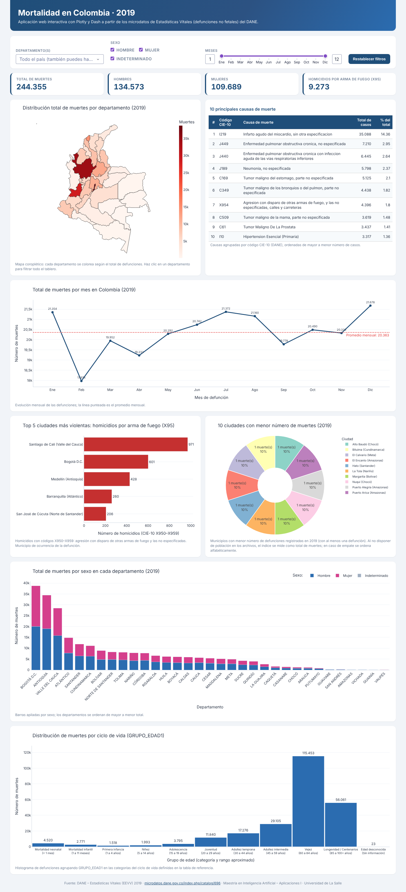
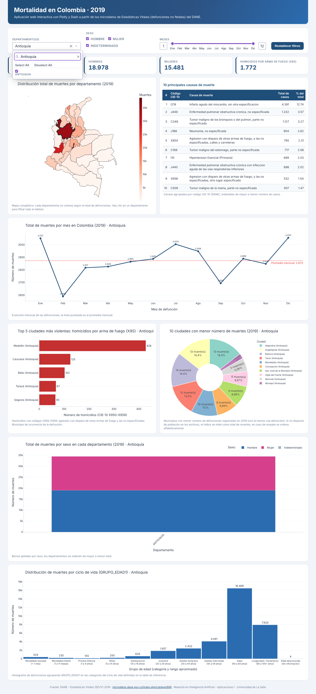
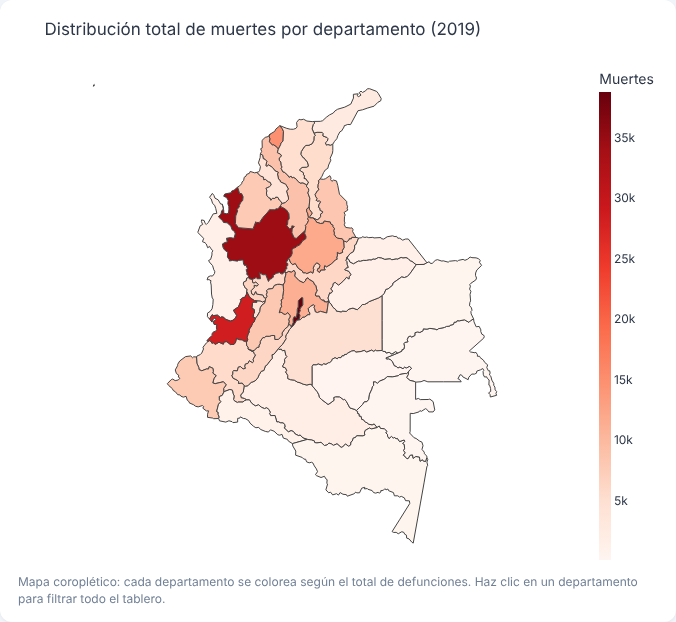
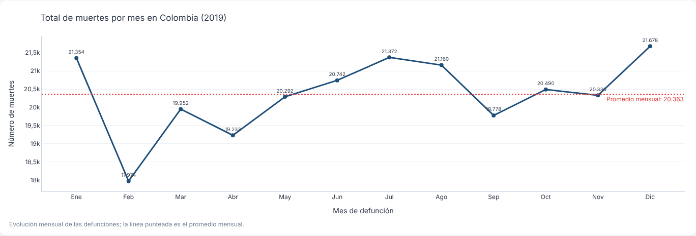
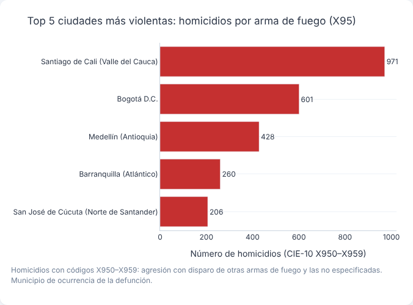
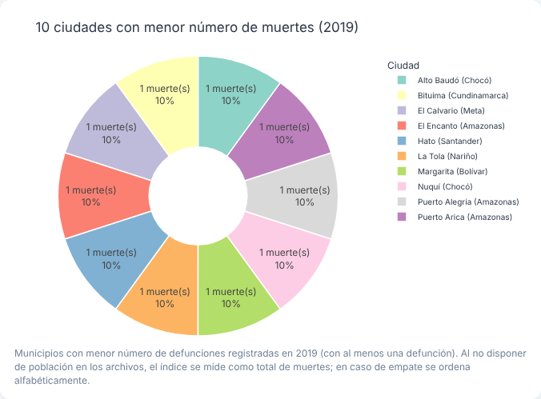
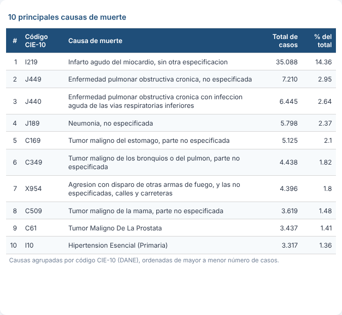
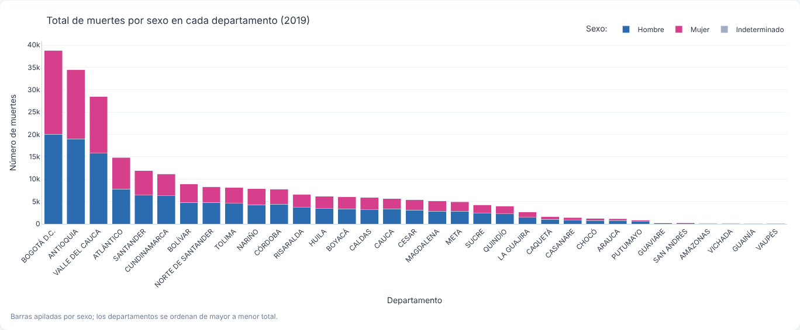
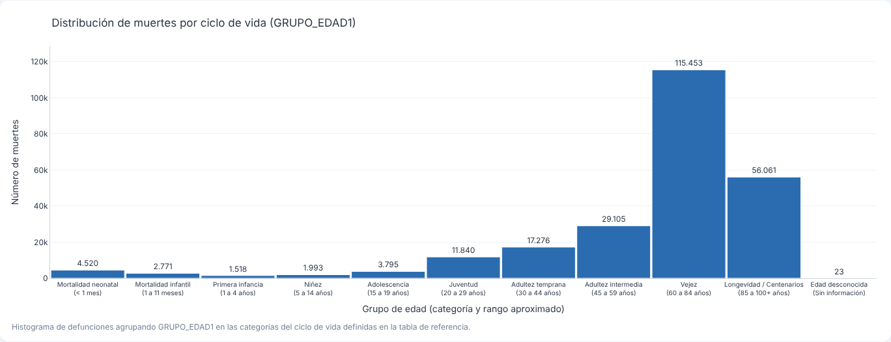

# Mortalidad en Colombia 2019 · Aplicación web interactiva con Dash

**Aplicación desplegada:** RENDER_URL
**Repositorio:** https://github.com/diegoforero44-afk/mortalidad-colombia-2019

Actividad 4 – Aplicaciones I (Maestría en Inteligencia Artificial, Universidad de La Salle).
Autor: **Diego Forero**.



---

## 1. Introducción

Esta aplicación web dinámica, construida en Python con **Plotly** y **Dash**, analiza las
**244.355 defunciones no fetales** registradas en Colombia durante **2019**, a partir de los
microdatos de Estadísticas Vitales (EEVV) publicados por el DANE. Reúne en un solo tablero un mapa
coroplético, gráficos de líneas, barras, barras apiladas, circular, un histograma por ciclo de vida
y una tabla de causas, todos conectados a filtros interactivos (departamento, sexo y rango de meses).

## 2. Objetivo

Identificar patrones **demográficos, temporales y regionales** de la mortalidad en Colombia en 2019:

- ¿Cómo se distribuyen las muertes entre departamentos?
- ¿Cómo varían a lo largo del año?
- ¿Qué ciudades concentran los homicidios por arma de fuego (CIE-10 X95)?
- ¿Qué municipios registran menos defunciones?
- ¿Cuáles son las 10 principales causas de muerte?
- ¿Qué diferencias hay entre hombres y mujeres por departamento?
- ¿En qué etapa del ciclo de vida se concentra la mortalidad?

## 3. Estructura del proyecto

```
mortalidad-colombia-2019/
├── app.py                      # Aplicación Dash (layout, gráficos y callbacks)
├── requirements.txt            # Dependencias de ejecución (Render las instala)
├── requirements-dev.txt        # + openpyxl, solo para regenerar los datos procesados
├── render.yaml                 # Configuración de despliegue (Blueprint de Render)
├── .python-version             # Versión de Python usada en Render (3.12)
├── assets/
│   ├── estilos.css             # Estilos del tablero (Dash los carga automáticamente)
│   └── topojson/world_110m.json# Mapa base servido localmente para el gráfico geográfico
├── data/
│   ├── raw/                    # Archivos fuente
│   │   ├── CodigosDeMuerte.xlsx        # Catálogo CIE-10 (DANE)
│   │   ├── Divipola.xlsx               # División Político-Administrativa
│   │   └── colombia_departamentos.geojson  # Polígonos de los 33 departamentos (MGN 2018)
│   └── processed/              # Datos livianos que usa la app
│       ├── defunciones_2019.csv.gz     # 244.355 registros, columnas necesarias
│       ├── divipola.csv
│       └── codigos_muerte.csv
├── scripts/
│   └── preprocesar.py          # Convierte los Excel del DANE en data/processed/
└── docs/img/                   # Capturas de pantalla usadas en este README
```

> El archivo `NoFetal2019.xlsx` (19 MB) no se versiona por tamaño; se descarga del aula virtual o del
> [catálogo del DANE](https://microdatos.dane.gov.co/index.php/catalog/696) y se ubica en `data/raw/`
> solo si se desea regenerar `data/processed/` con `scripts/preprocesar.py`.

### Fuentes de datos

| Archivo | Contenido | Uso |
|---|---|---|
| `NoFetal2019.xlsx` | Microdatos de defunciones no fetales 2019 (hoja `No_Fetales_2019`) | Registro base de cada muerte |
| `CodigosDeMuerte.xlsx` | Catálogo CIE-10 a 3 y 4 caracteres (hoja `Final`) | Nombre de la causa de muerte |
| `Divipola.xlsx` | Códigos y nombres de departamentos y municipios (hoja `Hoja3`) | Nombres de ciudades y departamentos |
| `colombia_departamentos.geojson` | Polígonos MGN 2018 por `DPTO_CCDGO` | Mapa coroplético |

Variables utilizadas: `COD_DANE`, `COD_DEPARTAMENTO`, `MES`, `SEXO` (1 hombre, 2 mujer, 3 indeterminado),
`GRUPO_EDAD1`, `MANERA_MUERTE` y `COD_MUERTE`.

## 4. Requisitos

- Python 3.12 (también probado con 3.13)
- Librerías (`requirements.txt`):

| Librería | Versión |
|---|---|
| dash | 4.5.0 |
| plotly | 7.1.0 |
| pandas | 3.0.5 |
| numpy | 2.5.3 |
| gunicorn | 26.2.0 |
| openpyxl (solo preprocesamiento) | 3.1.5 |

## 5. Despliegue en Render (PaaS)

1. Subir el proyecto a un repositorio público de GitHub (este repositorio).
2. En [render.com](https://render.com) → **New → Web Service** → conectar el repositorio de GitHub.
3. Configuración:
   - **Runtime:** Python 3
   - **Build Command:** `pip install -r requirements.txt`
   - **Start Command:** `gunicorn app:server --workers 1 --timeout 120 --bind 0.0.0.0:$PORT`
   - **Instance type:** Free
   - Variable de entorno `PYTHON_VERSION = 3.12.8`
4. **Deploy Web Service.** Render instala dependencias, arranca Gunicorn y publica la URL
   `https://<nombre>.onrender.com`.
5. Cada `push` a la rama `main` vuelve a desplegar automáticamente.

En `app.py` la línea `server = app.server` expone el servidor Flask interno de Dash para que
Gunicorn lo sirva. *Nota:* en el plan gratuito el servicio se suspende tras 15 minutos sin tráfico;
la primera visita puede tardar ~1 minuto en despertar.

## 6. Software utilizado

- **Python 3.12** – lenguaje de programación
- **Dash 4** – framework para aplicaciones web analíticas (layout + callbacks)
- **Plotly Express / Graph Objects** – gráficos interactivos
- **Pandas** – limpieza, cruces y agregaciones
- **Gunicorn** – servidor WSGI de producción
- **Render** – plataforma como servicio (PaaS)
- **Git / GitHub** – control de versiones
- **Visual Studio Code** – editor

## 7. Instalación y ejecución local

```bash
git clone https://github.com/diegoforero44-afk/mortalidad-colombia-2019.git
cd mortalidad-colombia-2019
python -m venv .venv
# Windows: .venv\Scripts\activate    |   macOS/Linux: source .venv/bin/activate
pip install -r requirements.txt
python app.py
```

Abrir <http://127.0.0.1:8050>. (Opcional) para regenerar los datos procesados:
`pip install -r requirements-dev.txt && python scripts/preprocesar.py`.

## 8. Visualizaciones y resultados

**Interactividad.** Todos los gráficos responden a los filtros de la parte superior: *Departamento(s)*
(lista desplegable o clic directo sobre el mapa), *Sexo* y *rango de meses*. Los indicadores
(total, hombres, mujeres, homicidios X95) y los títulos se actualizan con la selección. Cada
gráfico tiene información emergente (hover), zoom y descarga como PNG.


*Ejemplo: al seleccionar Antioquia, todos los gráficos se recalculan y el departamento queda resaltado en el mapa.*

### 8.1 Mapa – Distribución total de muertes por departamento



Bogotá D.C. (38.760), Antioquia (34.473) y Valle del Cauca (28.443) concentran el **41,6 %** de
todas las muertes del país, seguidos por Atlántico y Santander. Esto refleja principalmente el
**tamaño de la población**: son los territorios más poblados. Los departamentos de la Amazonía y
Orinoquía (Vaupés, Guainía, Vichada, Amazonas) registran menos de 400 muertes cada uno.

### 8.2 Gráfico de líneas – Total de muertes por mes



La mortalidad es relativamente estable (promedio de **20.363 muertes/mes**). **Febrero** es el mes
más bajo (17.974), en buena parte porque tiene menos días; **diciembre** (21.678), **enero** (21.354) y
**julio** (21.372) son los picos, coincidiendo con temporadas de vacaciones, festividades y
la circulación de virus respiratorios.

### 8.3 Barras – 5 ciudades más violentas (homicidios con arma de fuego, X95)



Se filtraron los códigos **X950–X959** (*agresión con disparo de otras armas de fuego y las no
especificadas*), que suman 9.273 casos en el país. **Santiago de Cali** encabeza con **971**
homicidios, muy por encima de Bogotá D.C. (601), Medellín (428), Barranquilla (260) y Cúcuta (206).
Cali, con cerca de la tercera parte de la población de Bogotá, registra 1,6 veces más homicidios por
arma de fuego, lo que evidencia un problema de violencia armada particularmente grave.

### 8.4 Gráfico circular – 10 ciudades con menor mortalidad



Trece municipios registraron **una sola defunción** en 2019; el gráfico muestra los diez primeros
(orden alfabético en empates), entre ellos varios corregimientos de **Amazonas** (Puerto Alegría,
Puerto Arica, El Encanto) y municipios de **Chocó** (Alto Baudó, Nuquí). Son territorios con muy
baja población y dispersos, donde además puede existir **subregistro** de defunciones. Como los
archivos no incluyen población, el índice se mide por número absoluto de muertes.

### 8.5 Tabla – 10 principales causas de muerte



| # | Código | Causa | Casos |
|---|---|---|---|
| 1 | I219 | Infarto agudo del miocardio, sin otra especificación | 35.088 |
| 2 | J449 | EPOC, no especificada | 7.210 |
| 3 | J440 | EPOC con infección aguda de vías respiratorias inferiores | 6.445 |
| 4 | J189 | Neumonía, no especificada | 5.798 |
| 5 | C169 | Tumor maligno del estómago | 5.125 |
| 6 | C349 | Tumor maligno de bronquios o pulmón | 4.438 |
| 7 | X954 | Agresión con disparo de arma de fuego, calles y carreteras | 4.396 |
| 8 | C509 | Tumor maligno de la mama | 3.619 |
| 9 | C61 | Tumor maligno de la próstata | 3.437 |
| 10 | I10 | Hipertensión esencial (primaria) | 3.317 |

El **infarto agudo de miocardio** es por mucho la primera causa (14,4 % de todas las muertes, casi
5 veces la segunda). Predominan las **enfermedades crónicas no transmisibles**: cardiovasculares,
respiratorias crónicas (EPOC) y cánceres (estómago, pulmón, mama y próstata). Llama la atención que
un **homicidio por arma de fuego en vía pública (X954)** aparezca en el séptimo lugar, por encima del
cáncer de mama.

### 8.6 Barras apiladas – Muertes por sexo en cada departamento



A nivel nacional mueren más hombres (**134.573; 55,1 %**) que mujeres (**109.689; 44,9 %**). La
proporción masculina supera el 50 % en todos los departamentos. Es más marcada en departamentos
periféricos y con presencia de conflicto armado como **Guaviare (77 % hombres)**, Guainía (68 %),
Amazonas (66 %), Vichada (65 %), Putumayo y Arauca (64 %), consistente con la mayor exposición de
los hombres a homicidios y accidentes; es menor en Bogotá D.C. (52 %) y Atlántico (53 %), donde
pesan más las causas crónicas asociadas al envejecimiento. 93 casos tienen sexo indeterminado.

### 8.7 Histograma – Distribución por ciclo de vida (GRUPO_EDAD1)



Se agruparon los códigos de `GRUPO_EDAD1` según la tabla de referencia (neonatal 0–4, infantil 5–6,
…, longevidad 25–28, desconocida 29). La **vejez (60–84 años)** concentra el **47 %** de las
muertes (115.453) y la **longevidad (85+)** otro 23 %; es decir, 7 de cada 10 defunciones ocurren
después de los 60 años. Se destaca un incremento en **juventud (20–29 años, 11.840)** frente a la
adolescencia, asociado a causas externas (homicidios y accidentes), y una mortalidad
**neonatal** (4.520) mayor que la de toda la primera infancia y la niñez juntas.

## 9. Conclusiones

1. La mortalidad en Colombia en 2019 está dominada por **enfermedades crónicas** en población
   adulta mayor, lo que orienta las políticas hacia prevención cardiovascular, respiratoria y
   oncológica.
2. La **violencia armada** sigue siendo un factor diferencial: afecta sobre todo a hombres jóvenes y se
   concentra en ciudades como Cali.
3. La visualización interactiva permite pasar del panorama nacional al detalle departamental en un
   clic, facilitando la comunicación de hallazgos y la toma de decisiones.

## Fuente

DANE – Estadísticas Vitales (EEVV) 2019:
<https://microdatos.dane.gov.co/index.php/catalog/696>
